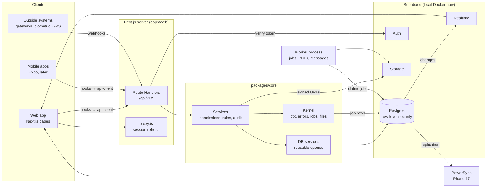

# 03 · Architecture

## The whole system on one page

## The seven layers

Data moves down for a write and up for a read. A layer talks only to the layer directly below it.

| # | Layer | Package | One file per module | May import | Must never |
|---|---|---|---|---|---|
| 1 | **Contract** | `@takhti/contracts` | `*.contract.ts` | `zod` only | Import the database or React |
| 2 | **Table** | `@takhti/db` | `*.table.ts` | contracts (for enum lists), Drizzle | Contain logic |
| 3 | **DB-service** | `@takhti/core` | `*.db-service.ts` | db, contracts, kernel | Check permissions or business rules |
| 4 | **Service** | `@takhti/core` | `*.service.ts` | db-services, kernel, contracts | Build SQL by hand, read the HTTP request |
| 5 | **Route** | `apps/web/app/api/v1` | `route.ts` | services, contracts, `server/route` | Contain any rule or query |
| 6 | **API-service** | `@takhti/api-client` | `*.api-service.ts` | contracts, the HTTP client | Import core or db |
| 7 | **Hooks** | `@takhti/hooks` | `*.hooks.ts` | api-client, contracts, React Query | Call `fetch` directly |

Above the hooks sit the **screens** (`apps/web`), which import hooks, contracts and UI components only.

ESLint enforces the "may import" column (`no-restricted-imports`, set per folder in `packages/eslint-config`, with a test for every rule in `tests/lint/`), so a wrong import fails the build. See [05 · Conventions](05-conventions.md).

### Why each layer exists

- **Contract.** One Zod file gives the route its validation, the client its types, the form its rules, the offline upload its checks and the AI tool its input schema.
- **Table.** Columns, constraints, indexes and row-level security in one place. Migrations are generated from it.
- **DB-service.** Queries are written once and reused by any service inside any transaction.
- **Service.** The only place a business rule lives. Four callers share it: routes, the offline upload, background jobs and AI tools.
- **Route.** Connects a URL to a service. Authentication, validation, the transaction and the error format come from one builder.
- **API-service.** Typed calls shared by web and mobile.
- **Hooks.** Caching, refetching and "refresh the list after a write" in one place.

## Life of a request

`PATCH /api/v1/students/5f0c…` with `{ "version": 3, "fullName": "Ayesha Imran" }`:

1. `proxy.ts` has already refreshed the Supabase session cookie if it was near expiry.
2. The route builder gives the request an id (`x-request-id`).
3. **Authenticate.** `auth.getClaims()` verifies the token's signature. The user's membership, roles, branches and permissions are loaded (cached for 60 seconds). The result is the **actor**.
4. **Rate limit** and, for money routes, the **idempotency** check.
5. **Validate.** Path, query and body are parsed by the contract. A failure returns `422` with messages per field.
6. **Open a transaction** and tell Postgres who is acting (`set_config('request.jwt.claims', …)`, `set local role authenticated`). From here row-level security filters every query.
7. **Service.** Checks the permission, loads the current row, runs business rules, calls db-services, writes the audit entry and queues any jobs — all inside the transaction.
8. **Commit.** If anything threw, everything rolls back, including the audit entry and the jobs.
9. **Respond** `200 { "data": … }`. The row leaves through the contract, so an internal column cannot leak.
10. **Client.** The hook stores the returned record and refreshes the lists that showed it.

Any error at any step becomes one shape: `{ "error": { "code", "message", "fields?", "requestId" } }`. See [08 · API standards](08-api-standards.md).

## Rules that keep it simple

1. **One door.** Screens never read the database. They call hooks, which call the API. This holds on the server too: a Server Component renders a shell and the client loads data. (Sign-in checks in layouts are the one exception.)
2. **`ctx` first.** Every db-service and service function takes `ctx` as its first argument. It carries the open transaction, the actor, the request id and the source (`api`, `sync`, `job`, `ai`). Calls sharing a `ctx` succeed or fail together.
3. **Factories for the common case.** A plain create/read/update/delete resource costs about 60 lines across layers 3 to 7. Custom behaviour is added as ordinary functions next to the generated ones.
4. **No hidden writes.** A database trigger is used only for `updated_at` safety nets and integrity checks, never for business behaviour. Behaviour lives in services where it can be read and tested.
5. **Derived values are computed.** Voucher balance, attendance percentage and stock on hand are computed from rows. They are frozen into a column only at a deliberate moment (publishing a result, closing a period).

## Processes

| Process | What it runs | Local command |
|---|---|---|
| Web | Next.js: pages and `/api/v1` | `pnpm dev` |
| Worker | Claims jobs from Postgres: notifications, PDFs, bulk runs, imports, exports, scheduled work | `pnpm worker` |
| Supabase | Postgres, Auth, Storage, Realtime, Studio, mail catcher | `pnpm db:start` |
| PowerSync (Phase 17) | Sync service for offline devices | `pnpm sync:start` |

## Environments

| Name | Database | Purpose |
|---|---|---|
| `local` | Supabase in Docker, database `postgres` | Daily development, with seed data |
| `test` | PGlite in memory (default) or database `takhti_test` in the same Docker Postgres | Automated tests |
| `staging` | Supabase Cloud project (Phase 21) | Final checks with real integrations in sandbox mode |
| `production` | Supabase Cloud project (Phase 21) | Schools |

The same migrations and the same code run in all four. Only environment variables differ. See [17 · Local environment](17-local-environment.md).

## How the other pieces attach

- **Realtime.** Used for three things only: chat, the in-app notification bell, and live dashboards. A client subscribes to a Supabase Realtime channel; row-level security applies because the user's own token is used. Realtime is an improvement, never a requirement: every screen also works by refetching.
- **Files.** The client asks the API for a signed upload URL, uploads straight to Storage, then tells the API. Downloads are short-lived signed URLs. See [13](13-notifications-jobs-and-files.md).
- **Jobs.** A service calls `enqueue(ctx, …)`; the job row commits with the data. The worker runs it with retries. See [13](13-notifications-jobs-and-files.md).
- **Offline (Phase 17).** PowerSync copies each staff member's slice of the data to SQLite on the device. Offline writes queue on the device and are posted to `/api/v1/sync/upload`, which calls the same services. See [14](14-offline-design.md).
- **AI (Phase 19).** Tools given to the model are the same service functions, called with the asking user's `ctx`. See [15](15-ai-design.md).
- **Mobile (Phase 23).** Expo apps import `contracts`, `api-client` and `hooks` and send the Supabase token as a bearer header.

## Self-hosting

Every piece can run without a cloud vendor: Next.js as a Docker image, Supabase with its Docker stack, PowerSync Open Edition, the worker as a plain Node process. This keeps two doors open: moving to a data centre inside Pakistan if the law requires it, and an on-premise edition for a school that insists on its own server.
